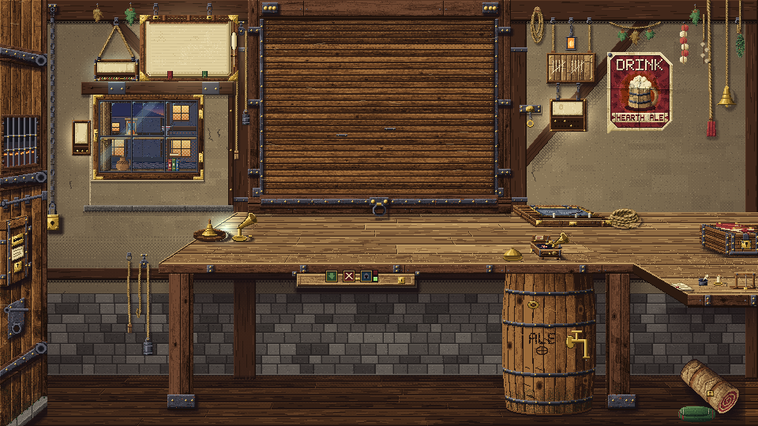

# Medieval Tavern (early access)



A texture pack for [Texture Packs](https://github.com/KCN-judu/ProbablyStolen-TexturePacks), a mod for *Probably Stolen*: the whole game redrawn as a medieval timber-framed tavern. The shop is a bar under a serving window, with casks, a gramophone and a counting-house chest; the people wear hoods and coifs and kettle helms; the interface is wood, iron, brass and parchment.

**Early access.** It is still being refined and some pictures are weaker than others. Discussion during development: [Discord thread](https://discord.com/channels/1315752321975845004/1567431485391372339).

## Use

1. Install [Texture Packs](https://github.com/KCN-judu/ProbablyStolen-TexturePacks) (it is the mod that loads packs).
2. Copy this folder into the game's `Mods` folder (or take the folder from a [release](https://github.com/KCN-judu/ProbablyStolen-MedievalTavern/releases)).
3. Enable **Texture Packs** and **Medieval Tavern** in the Mods menu and restart the game. The pack manager (the Texture Packs button in the Mods menu) orders and switches packs.

The pack needs no special permissions. It is made for game version 0.46D.

## What it covers

1831 of the 1835 pictures a pack can replace: the shop and its fixtures, the main menu and its three background pictures, every window and button, the item pictures, the appraisal close-ups, the perk icons, the customers and the people passing the window. The four left out are the game's title logo and the Steam and Discord pictures.

Every modern or sci-fi object became an ancient device that does the same job: the telephone a brass speaking tube and handbell, the PC a counting-house cabinet with an abacus and a ledger, the tape recorder a gramophone with a record, cables bell-pulls and chains, the electric lamp a candle bar, the shotgun a longbow, the trash can a cask with a sight tube, the vending machine a pie cupboard.

## How it is made

Nearly every picture is drawn by Python from a palette, a few materials and a seed (`tools/tavern`), so the same code always draws the same picture; nothing of the game's art is read, only numbers (each picture's size and where its content sits). The customers and the passers-by are the exception: the game's own pictures are edited, with hats, hoods, clothes and make-up drawn from scratch (`tools/overlay`), which keeps the faces and the lighting of the game's art. The publisher has said such edits, and publishing them, are allowed.

To rebuild everything you need your own copy of the game's pictures, exported with the Texture Packs creator kit:

```
python <kit>/export/export.py "<game folder>" --out exports
tools/tavern/make_pack.sh exports
```

Without the export, `python tools/tavern/build.py` draws every picture from code alone (the customers then come out fully redrawn). [tools/tavern/README.md](tools/tavern/README.md) lists the code and what is drawn.

The set of hats, clothes and marks in `tools/overlay/parts` is drawn entirely from scratch and holds no game art; its contact sheets are `hats_sheet.png`, `garments_sheet.png` and `marks_sheet.png`.

## Licence

- **Code** (the scripts under `tools/`, the data files): Apache License 2.0, see `LICENSE`.
- **Assets** (the pictures in `Textures/`, the overlay parts, the sheets and the preview): [Medieval Tavern Assets License](LICENSE-ASSETS.md). You may use them, make derivative works and redistribute those, but you may not redistribute the assets themselves.
- The customer and passer-by pictures are the game's own art edited here with the publisher's permission; the licence covers only the edits.
